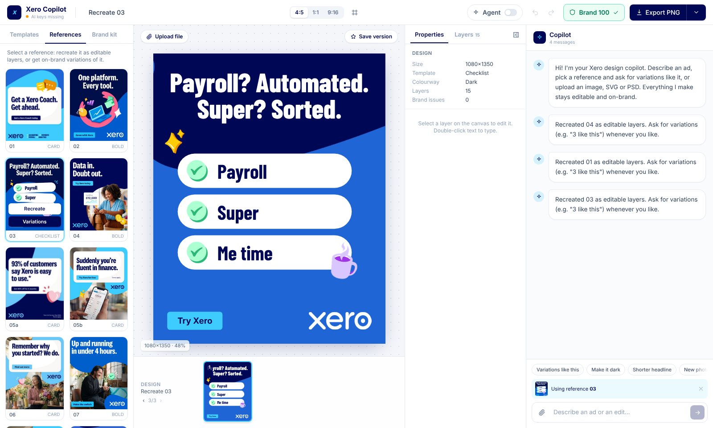
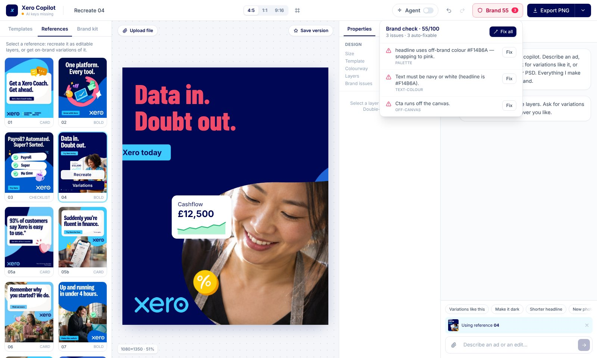
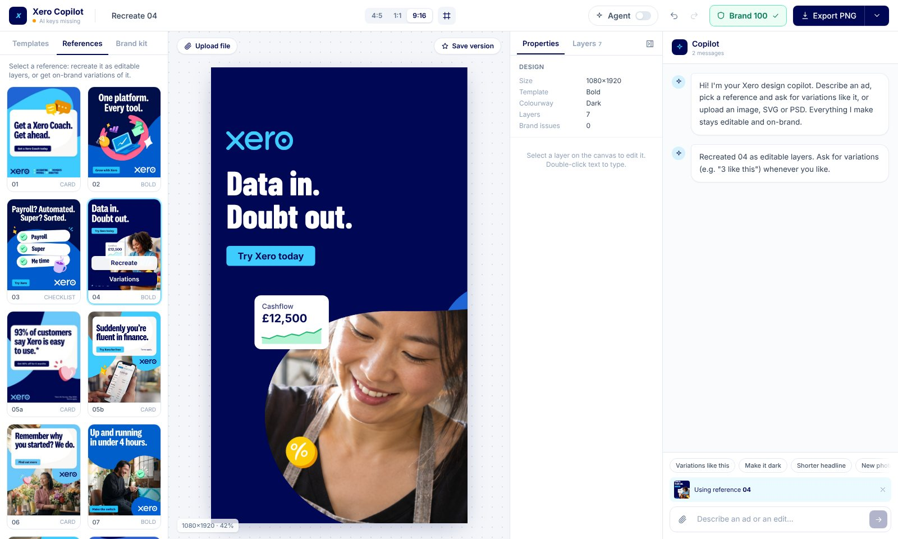
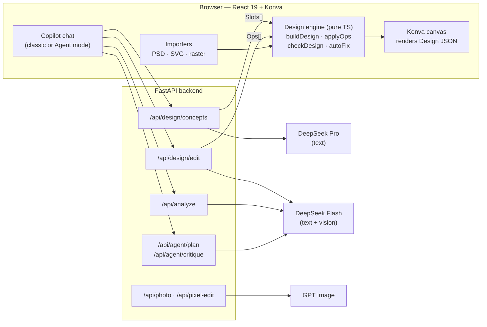

# Xero Copilot — an agentic, on-brand ad editor

[](https://github.com/sreekarp/crux-ad-editor/actions/workflows/ci.yml)


An AI copilot that lives inside an image editor. You describe an ad, point at a reference and ask for
**"4 different images like this"**, or drop in a Photoshop file, and the copilot produces **layered, editable designs
that follow the Xero brand kit** — not flat AI pictures.

Built solo in one day at the **GetCrux AI hackathon** (17 October 2026), against a brief to build an agentic image
editor for a real brand.



## Highlights

- **The LLM never places pixels.** Models choose *what to say* (copy, template, colourway, photo, charms); deterministic
  TypeScript lays the design out. That one decision is why every output is on-brand, editable and testable.
- **A brand guard, written as code.** 18 rules from the brand guidelines (palette, logo colour per background, the logo
  pill over photos, one CTA, safe margins, Meta's 9:16 safe zone, disclaimers…) are checked live, scored 0–100 and
  fixed in one click.
- **An agent that checks its own work.** In Agent mode the copilot asks clarifying questions only when the answer would
  change the output, then renders each design, scores it (brand checker + vision critique), applies a fix, re-scores,
  and keeps whichever version scored higher.
- **Real file import.** PSD type layers and SVG text come in as editable text; pixel layers become movable layers.
- **Built to survive a live demo.** Every model call has a timeout and a fallback, a pre-generated photo bank keeps
  generation fast, and **Recreate** works with no AI at all.
- **168 unit tests** cover the design engine, brand rules, importers and agent logic.

## What it does

| Mode | How it works |
|---|---|
| Blank → design | Describe the ad in chat ("4 concepts for florists about cash flow"). The copilot writes the copy and picks layouts, photos, charms and colourways. |
| Reference → variations | Pick one of the 20 reference ads, or upload your own. **Recreate** rebuilds it as editable layers instantly. "Create 4 different images like this" keeps its structure and varies the angle, photo and colourway. |
| Edit with chat or by hand | "Make it dark", "shorter headline", "use a photo of a baker", "make it 9:16" — or drag, resize, double-click to type, reorder layers, undo/redo. |
| Import PSD / SVG / PNG | Photoshop type layers and SVG text become **editable text**. PNG/JPG come in as a locked image that can be pixel-edited or recreated as layers. |
| Brand guard | Live score badge with every issue listed, a per-issue **Fix** and **Fix all**. Off-brand requests ("make the logo red") are declined with an on-brand alternative. |
| Export | Pixel-exact PNG (1080×1350, 1080×1080, 1080×1920), 2× PNG, JPG, every variation at once, or the editable design file (`.json`), which reopens when dropped back on the canvas. |

<table>
  <tr>
    <td width="50%"></td>
    <td width="50%"></td>
  </tr>
  <tr>
    <td><b>Brand guard.</b> A broken design scores 55/100; every issue is explained and auto-fixable.</td>
    <td><b>Reflow, not stretch.</b> The same design rebuilt for 9:16 inside Meta's safe zones.</td>
  </tr>
</table>

## How it works



### Slots and Ops: the model decides, code draws
The model never outputs coordinates. It either fills **Slots** — template, colourway, headline, sub, CTA, hero photo,
charms, stat card — or emits **Ops**: `update`, `add`, `delete`, `reorder`, `rebuild`, `resize`, `photo`,
`pixel_edit`. `buildDesign(slots)` turns Slots into layers using five templates derived from the 20 reference ads, and
`applyOps(design, ops)` applies every edit as an undoable step. Because layout is ordinary code, it is unit-tested,
and a brand rule can never be "forgotten" by the model.

### Guardrails on what the model writes
- JSON mode plus Pydantic schema validation. If one model tier errors, the call falls back to the other (Pro ↔ Flash).
- Copy checks: copying an existing ad, inventing statistics, offers or claims, or breaking length limits triggers one
  repair pass, and a final safety net strips any offer or claim the user never gave.
- Every applied edit runs through the brand checker with auto-fix, so an off-brand request can't land on the canvas.

### Agent mode: understand → build → review
Agent mode (toggle in the top bar, off by default) adds two loops on top of the classic pipeline:

1. **Understand.** An LLM planner decides whether the request is clear. If something important is missing (audience,
   offer, how many options, format), it asks up to three questions as clickable chips, once. "Just go" is always there.
2. **Review.** Each new design is rendered offscreen and scored: the deterministic brand checker plus a Flash vision
   critique. The agent applies one fix per round, re-renders, re-scores and **keeps the better version** (up to two
   rounds, about 45 s per design). The score change is shown in chat, e.g. `72 → 88`.

Before each critique, code also checks that the photo subject's head is fully visible inside its bloom-shaped crop, and
re-fits the photo if not.

### Variations from an uploaded image
1. The upload is imported as a design, and a flattened preview is stored on the server.
2. `/api/analyze` reads it with Flash vision into Slots. The agent plays back what it saw, and the user can correct it.
3. `/api/design/concepts` writes new concepts grounded in that image (Flash, 60 s cap). If that fails it falls back to
   the text-only Pro model using the Slots alone.
4. Code lays out the layers and photos come from GPT Image or the photo bank. The upload's pixels are never reused.

### Engineering details worth knowing
- **Same-origin assets.** Vite proxies `/api` and `/static` to the backend, so images never taint the canvas and PNG
  export keeps working.
- **Fonts before first draw.** The canvas waits for `document.fonts` to load, otherwise Konva measures and wraps text
  with the fallback font.
- **Time budgets everywhere.** Backend budgets (26 s plan, 29 s critique) are set just under the frontend timeouts, so
  calls fail cleanly instead of racing.
- **Headless render route.** `/?render=ref:<id>&size=9:16` renders a design with no UI, for screenshots and checks.

## The brand kit, as code
- **Palette:** navy `#000856`, blue `#1F65D6`, sky `#3ECCFF` and white, plus bloom accents mint, yellow, pink and lilac.
  Text is navy or white only.
- **Logo:** sky or white on navy, navy on sky or white, white on blue; a logo pill over photos.
- **Blooms:** the 12 official shapes, tinted at render time and scaled beyond the frame; photos are cropped into chunky
  blooms or rounded frames.
- **Assets:** 325 3D charms (65 types × 5 colours) sliced from the brand sheet, 7 product-UI device shots,
  14 illustrations, 18 background templates and a 42-photo bank.
- **Fonts:** Barlow Condensed and Inter as free stand-ins for the licensed National 2 (a one-line config swap).

## Tech stack

| Area | Choices |
|---|---|
| Frontend | React 19, TypeScript, Vite, Konva / react-konva, Zustand, Tailwind CSS 4, ag-psd |
| Backend | Python, FastAPI, Pydantic, the OpenAI SDK (for both DeepSeek and GPT Image), Pillow, NumPy |
| Models | DeepSeek-V4-Pro (concepts), DeepSeek-V4.1-Flash (edits, vision, planning, critique), GPT Image (photos, pixel edits) |
| Testing | Vitest (168 tests), TypeScript strict type-check, GitHub Actions |

## Run it locally

You need Python 3.12+, Node.js 22+ and API keys for an OpenAI-compatible DeepSeek endpoint and OpenAI image
generation. Without keys the editor still runs: templates, **Recreate**, manual editing, import, the brand guard and
export all work offline.

**1. Configure keys.** Copy `.env.example` to `.env` in the project root and fill it in:

| Variable | Used for |
|---|---|
| `DEEPSEEK_PRO_KEY`, `DEEPSEEK_PRO_BASE_URL`, `DEEPSEEK_PRO_MODEL` | Concepts (text only) |
| `DEEPSEEK_FLASH_KEY`, `DEEPSEEK_FLASH_BASE_URL`, `DEEPSEEK_FLASH_MODEL` | Edits, image analysis, Agent mode |
| `OPENAI_API_KEY`, `IMAGE_MODEL` | Photos and pixel edits |
| `PRO_TIMEOUT`, `FLASH_TIMEOUT`, `IMAGE_TIMEOUT` (optional) | Per-call timeouts in seconds (defaults 120 / 60 / 200) |

**2a. Windows — one command.**
```powershell
powershell -ExecutionPolicy Bypass -File .\start.ps1             # set up if needed, start both servers, open the app
powershell -ExecutionPolicy Bypass -File .\start.ps1 -Restart    # restart the servers to pick up code changes
```
[`start.ps1`](start.ps1) creates `backend/.venv`, installs both sides only when the lockfiles change, starts FastAPI on
`:8000` and Vite on `:5173`, waits for both and opens the browser.

**2b. macOS / Linux.**
```bash
# backend (terminal 1)
cd backend
python3 -m venv .venv && .venv/bin/pip install -r requirements.txt
.venv/bin/python -m uvicorn app.main:app --port 8000

# frontend (terminal 2)
cd frontend
npm ci && npm run dev        # http://localhost:5173
```

`http://localhost:8000/api/health` reports any missing keys.

### Checks
```bash
cd frontend
npm run typecheck   # TypeScript
npm test            # Vitest, 168 tests
npm run build       # production build
```
`backend/scripts/smoke_test.py` checks the live model endpoints (latency, JSON mode, vision, one image).

## Repo map

| Path | What's there |
|---|---|
| `frontend/src/design/` | Templates, brand checker, Ops engine, photo fitting (pure TS, tested) |
| `frontend/src/agent/` | Agent mode: planner client, clarifying questions, render-and-review loop |
| `frontend/src/editor/`, `frontend/src/canvas/` | Editor UI, Konva renderer, copilot flows, Zustand store |
| `frontend/src/import/` | PSD, SVG and raster import to editable layers |
| `backend/app/` | FastAPI app, prompts, validation, LLM and image clients, agent endpoints |
| `backend/data/references.json` | The 20 reference ads, recreated as Slots |
| `backend/scripts/` | Asset pipeline (slicing the charm sheet, bloom masks, logo), photo bank, smoke test |
| `docs/` | [Interface contract](docs/CONTRACT.md), [original plan](docs/PLAN.md), [demo script](docs/DEMO.md), [Agent mode spec](docs/superpowers/specs/2026-10-17-agent-mode-design.md), pitch deck |

## How it was built
The work was split into workstreams — assets, backend, editor, design engine and importers — that met at one typed
contract ([`docs/CONTRACT.md`](docs/CONTRACT.md), with types in `frontend/src/types.ts`). That let them be built in
parallel with AI coding agents (Claude Code), which the hackathon required, while the contract and tests kept the parts
consistent. Agent mode was specified in a design doc first and then implemented against it.

## Known limitations
- Fonts are free stand-ins for the licensed brand fonts, and charm artwork is upscaled from small sources.
- DeepSeek Pro is text-only, so image-grounded variations are written by Flash, a weaker copywriter. The same copy and
  brand checks apply, and the app falls back to Pro without the image if Flash fails.
- The two-column comparison in reference 09 renders as standard checklist rows.
- The frontend ships as one large bundle; the PSD importer is the main candidate for code-splitting.

## Brand assets
The Xero brand kit, reference ads and product imagery in `assets/` and `backend/static/` were provided by the hackathon
organisers for this challenge and belong to Xero. They are included only so the project runs as built; this repository
is a personal project and is not affiliated with or endorsed by Xero.
